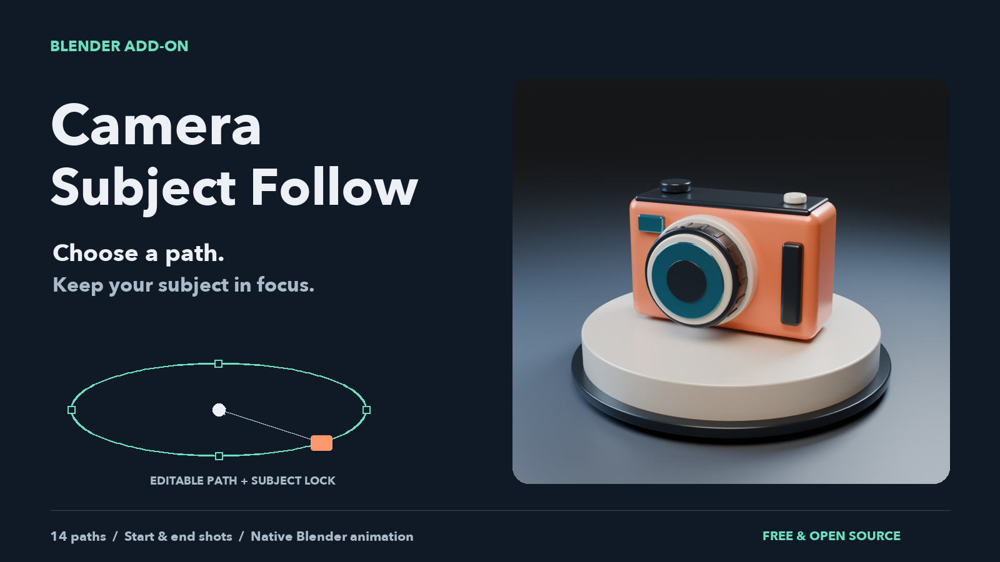
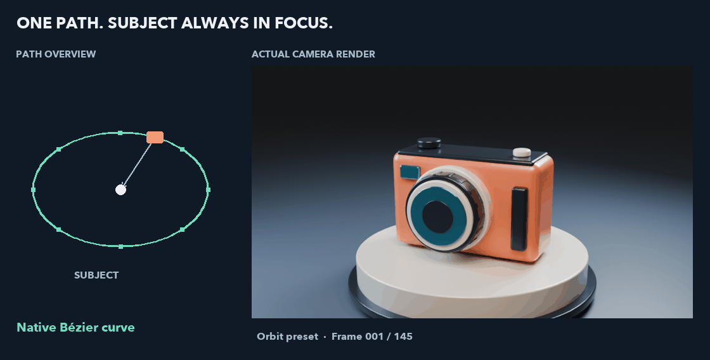
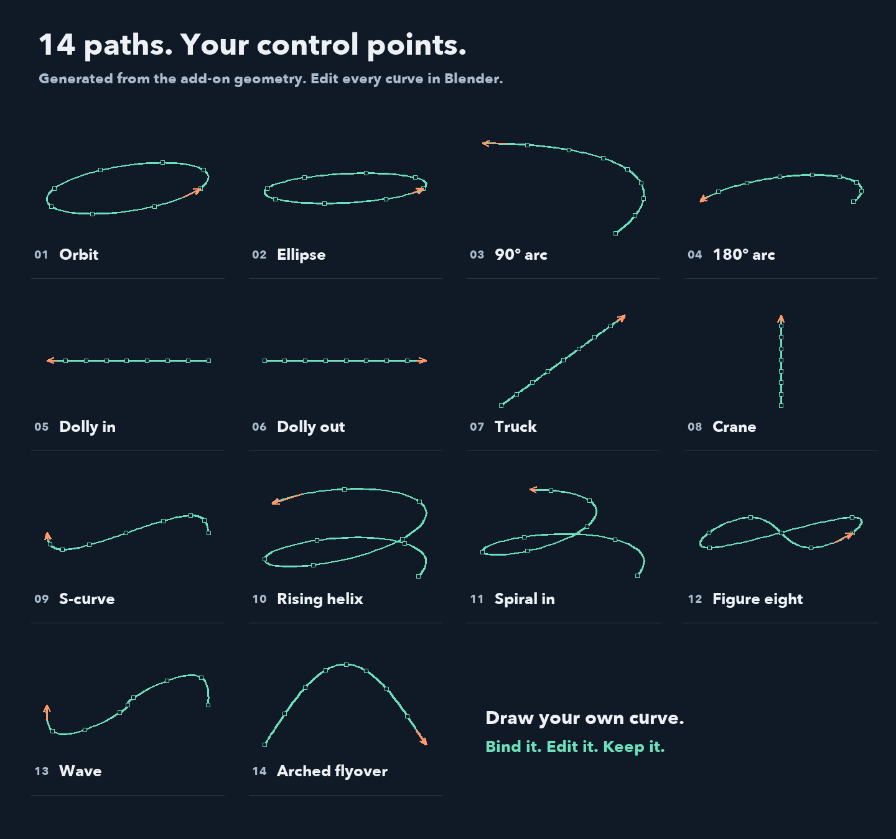

# Blender Camera Subject Follow

**Build an editable camera move, and keep your subject in focus.**

[中文说明](README.zh-CN.md) · [Download the add-on](https://github.com/maixuanfeng-1/blender-camera-subject-follow/releases/latest) · [Full guide](docs/GUIDE.md) · [Report a bug](https://github.com/maixuanfeng-1/blender-camera-subject-follow/issues/new/choose)

Creating a product orbit should not require rebuilding a tracking rig for every scene. This free Blender add-on connects **editable Bézier paths, subject tracking and depth-of-field focus** in one sidebar. Use a preset, draw your own curve, or record the opening and closing shots.

No account, paid service, external Python dependency or network request is required by the add-on.

## See what it does

The frames above come from the actual add-on and the included [original demo scene](examples/camera-follow-demo.blend). The path overview and captions are added for explanation; they are not a screenshot of the Blender interface. No third-party models or textures are needed.

| You want to… | Use this |
| --- | --- |
| Make a product orbit or reveal | Create one of 14 path presets and bind the camera |
| Keep a moving subject in focus | Pick a subject; enable aim tracking and/or depth-of-field focus |
| Plan a move between two compositions | Record start/end shots; generate an editable connecting curve |
| Adjust the route by hand | Edit, subdivide or extend native Bézier control points |
| Use a curve you already drew | Pick the curve, then bind the camera |
| Send the animation to a collaborator | Save the `.blend`; existing motion uses native constraints and keys |

## Install

1. Open [Releases](https://github.com/maixuanfeng-1/blender-camera-subject-follow/releases/latest) and download **`camera_subject_follow-v1.2.1.zip`**. Keep this ZIP intact.
2. In Blender, open **Edit → Preferences → Add-ons → Install from Disk** (use the drop-down menu if necessary).
3. Select the downloaded ZIP and enable **Camera Subject Follow**.
4. In the 3D View, press **N** and open **相机跟随** (Camera Follow).

The current interface is in **Simplified Chinese**. The English guide includes a [button label reference](docs/GUIDE.md#button-reference). English interface localization is a welcome contribution.

**Download the release asset above.** GitHub's automatically generated “Source code” ZIP contains the whole repository and is not the add-on installer.

## Your first move

1. Pick the scene camera in **主体锁定与对焦** (Subject & Focus).
2. Click the eyedropper beside **跟随主体** and select your subject. You can also select an object first and click **使用选中物体**.
3. Under **贝赛尔路径预设**, choose an orbit or another path. Adjust radius and height for your scene.
4. Set the frame range under **运镜动画**.
5. Click **创建预设并绑定相机**, switch to camera view and play.

To try the working example, download [camera-follow-demo.blend](https://github.com/maixuanfeng-1/blender-camera-subject-follow/releases/latest), open it and play frames **1–145**. Install the add-on to adjust its sidebar controls; the existing animation also plays without the add-on.

## 14 editable paths

Orbit · ellipse · 90° arc · 180° arc · dolly in · dolly out · truck · crane · S-curve · rising helix · spiral in · figure eight · wave · arched flyover.

You can also choose linear, eased or sine timing; play once, repeat or ping-pong; reverse direction; or play only a chosen segment. Paths can translate with a subject when created or rebuilt with that option enabled.

## Start and end with the shot you want

Record the opening and closing views from the current viewport, active camera or reference cameras. Generate a straight, curved or S-shaped Bézier connection, then keep editing its control points.

Choose **Match start/end framing** to animate orientation and lens framing, or **Keep looking at subject** to retain subject tracking. You can also record two positions on an existing bound curve and animate just that interval without replacing the curve. See the [English guide](docs/GUIDE.md) or [中文完整指南](docs/GUIDE.zh-CN.md).

## Compatibility and limits

| Version | Evidence |
| --- | --- |
| Blender 4.3.2, macOS | Four integration suites passed locally |
| Blender 5.1.0, macOS | Four integration suites passed locally |
| Blender 4.2+ | Declared minimum; other releases/platforms need confirmation |

The add-on preserves original camera/lens animation for pause and unbind operations; test on a copy when combining it with a complex existing rig. The tests cover native constraints, save/reopen behavior, endpoint framing, path presets and picker logic. Mouse picking in every UI layout has not been exhaustively tested.

- Tracking aims at the **subject origin**. Parent an Empty to the object to focus on a specific point.
- There is no obstacle avoidance, automatic collision check or automatic constant subject size.
- Matching start/end shots requires the same projection type at both ends.
- Rebuilding a preset replaces its edited control points. Creating another preset keeps the old curve.
- Free camera navigation can feel constrained while aim tracking is enabled. Pause **持续朝向主体** to compose freely.
- Existing saved animation works without the add-on; editing add-on settings requires it to be installed.

## Help make it better

If this saves you time, a **star** helps other Blender users find it. Useful bug reports, translations and example shots are just as welcome. Include your Blender version, operating system and a small reproducible scene when reporting a problem.

[Contributing](CONTRIBUTING.md) · [Test evidence](docs/VALIDATION.md) · [Changelog](CHANGELOG.md)

## License and credits

**GPL-3.0-or-later**. Free to use, study, modify and redistribute under that license, including commercial workflows. Rendered output is not required to use the software's license merely because it was rendered with this add-on.

Maintained by [@maixuanfeng-1](https://github.com/maixuanfeng-1). The original code was developed with OpenAI Codex; its original code attribution is preserved. The demo scene and diagrams are original project assets. This is an independent community add-on.
