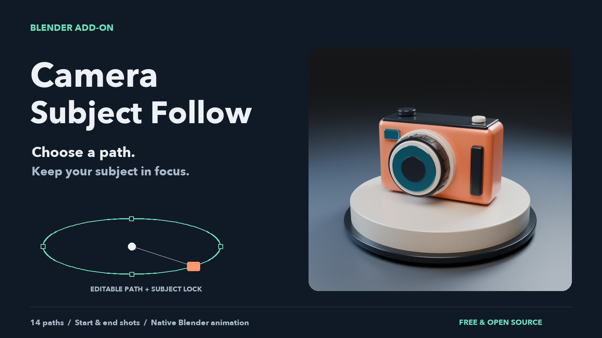
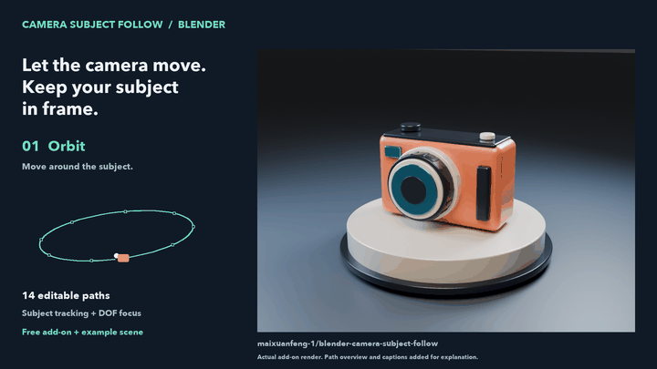
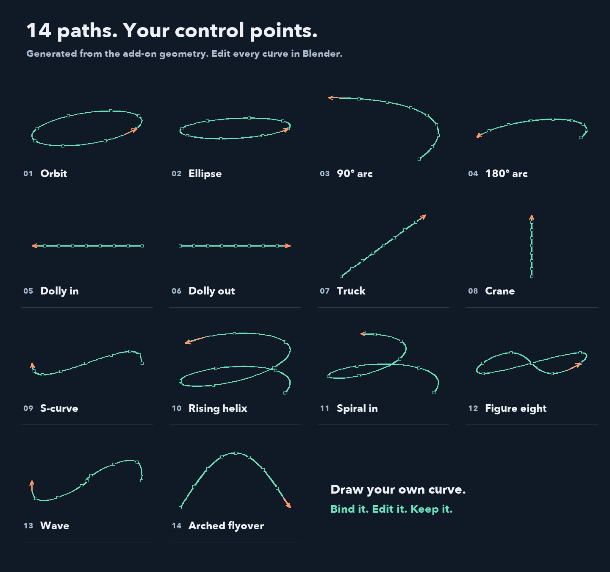

# Blender 相机主体跟随与贝塞尔运镜

**画一条路线，让相机沿路运动，始终看向并对焦主体。**

[English](README.md) · [观看真实演示](https://maixuanfeng-1.github.io/blender-camera-subject-follow/) · [下载插件](https://github.com/maixuanfeng-1/blender-camera-subject-follow/releases/latest) · [三分钟试用](docs/TRY.md#三分钟试用)

做一次产品环绕，不必每次重新搭建相机约束。这个免费开源插件把 **14 种可编辑贝塞尔路径、相机朝向跟随、景深自动对焦和首尾画面连接** 放在一个侧栏里。

插件无需登录、订阅、联网或安装额外 Python 依赖。支持商业项目使用，源码按 GPL-3.0-or-later 开放。

## 先看效果

演示由实际插件和随仓库提供的原创示例工程生成。左侧路径示意和文字是后期说明，不是 Blender 界面截图。模型与材质均由代码生成，没有外部素材依赖。[观看 16 秒视频](https://maixuanfeng-1.github.io/blender-camera-subject-follow/)。

**欢迎首批试用：** 按 [三分钟试用](docs/TRY.md#三分钟试用) 改一次示例的环绕半径，再用 [试用反馈表](https://github.com/maixuanfeng-1/blender-camera-subject-follow/issues/new?template=trial.yml) 告诉我 **Blender 版本、系统、是否跑通**。下载和获得帮助都不以 Star 为条件。

## 适合解决什么问题

| 需求 | 对应功能 |
| --- | --- |
| 产品环绕、展示、推进、拉远 | 14 种路径预设，一键绑定相机 |
| 相机移动时仍看向物品 | 吸管选主体，持续朝向与景深对焦独立开关 |
| 已经想好开头和结尾构图 | 记录首尾画面，生成可继续编辑的连接曲线 |
| 希望自己调整运动路线 | 移动、细分、延伸原生贝塞尔控制点 |
| 已经画好自己的曲线 | 吸管选曲线后绑定相机 |
| 把动画交给其他人继续使用 | 原生约束与关键帧，保存后已有动画可脱离插件播放 |

## 安装与第一次使用

1. 进入 [Releases](https://github.com/maixuanfeng-1/blender-camera-subject-follow/releases/latest)，下载 **`camera_subject_follow-v1.2.1.zip`**，不用解压。
2. 在 Blender **编辑 → 偏好设置 → 插件 → 从磁盘安装** 中选择这个 ZIP，再启用 **Camera Subject Follow**。部分版本需先点右上角菜单。
3. 回到 3D 视图，按 **N → 相机跟随**。
4. 选择摄像机，用 **跟随主体** 右侧吸管点选要拍的物体。
5. 选路径样式，调整半径、高度和起止帧，点击 **创建预设并绑定相机**。
6. 切到相机视图并播放。想加点或改路线，进入 **路径绑定与控制点 → 编辑控制点**。

**请下载 Release 中的插件安装包。** GitHub 自动生成的 “Source code” 压缩包是完整仓库，不是插件安装包。

想直接体验，可从同一发布页下载 **`camera-follow-demo.blend`**，打开后播放 **1–145 帧**。已有动画无需安装插件也能播放；修改插件设置需先安装插件。

## 14 种路径与首尾画面

圆形、椭圆、90° 弧线、180° 半环绕、推进、拉远、横移、升降、S 形、螺旋升降、螺旋收拢、8 字、波浪、拱形飞越。

支持匀速、柔和启停、正弦缓动、反向、重复与往返。也可以用已有曲线，只播放选定的一段。

在 **首尾画面** 面板记录开始和结束的构图后，可以生成直线、弧线或 S 形连接。选择 **匹配首尾构图** 会过渡方向和镜头参数；选择 **持续看向主体** 会保持主体锁定。完整操作和边界情况见 [使用指南](docs/GUIDE.zh-CN.md)。

## 兼容性与边界

本次在 macOS 的 **Blender 4.3.2、5.1.0** 上分别通过四组集成验证。代码声明最低版本为 4.2，其他版本和系统仍欢迎反馈。验证覆盖路径、对焦、首尾构图、保存重开与拾取逻辑；不能代表所有 UI 布局和复杂相机 rig 都已测试。

- 跟随点是物体原点；需要对准细节时，可使用父级绑定到主体的空物体。
- 不自动避障或检测碰撞，也不自动变焦来保持主体画面大小。
- 首尾参考需使用相同投影类型；重新按预设构建会替换手动改过的控制点。
- 朝向跟随开启时，自由平移构图会受约束；可暂时关闭 **持续朝向主体**。
- 插件不会因安装而自动保存工程。复杂工程请先用副本试用。

## 一起完善

如果它节省了你的时间，欢迎点一个 **Star**，让更多 Blender 用户找到它。提交真实问题、补充教程、贡献翻译和分享案例也很有帮助。

[贡献说明](CONTRIBUTING.md) · [验证记录](docs/VALIDATION.md) · [版本记录](CHANGELOG.md)

维护者：[@maixuanfeng-1](https://github.com/maixuanfeng-1)。初始代码使用 OpenAI Codex 辅助开发，保留原代码署名。采用 **GPL-3.0-or-later**，可用于商业工作流；仅使用插件渲染，不会使你的渲染作品必须采用同一许可。这是独立社区插件。
